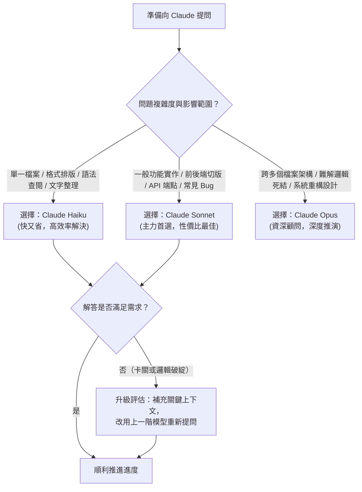

# Claude 模型比較與選擇指南：培養工程師的 AI 資源思維

> **紀錄日期**：2026/10/18
> **核心目標**：學會運用 **What（這是什麼）**、**Why（為什麼選它）**、**How（如何決策與操作）** 建立工程思維，在專題開發中達到效能與成本的最佳平衡。

> [!NOTE]
> **本系列手冊的使用環境**：01～05 以 **Claude Code** 為主要操作環境，06 介紹 **Cowork**。文中的 `CLAUDE.md`、`settings.json`，以及 `/model`、`/usage`、`/context` 等指令，都是 Claude Code 的功能。若你使用的是網頁版聊天介面或其他工具，可用的功能與畫面會不同，但選模型、提問與安全使用的觀念仍然適用。

---

## 導言：為什麼工程師需要學習「選模型」？

在過去，軟體工程師寫程式主要消耗的是個人的腦力與時間；但在當前與未來的現代化 AI 輔助開發中，**AI 的運算資源（Tokens 與呼叫額度）本身就是一項關鍵的工程成本**。

在職訓局的培訓環境中，每位同學都配發了專屬的學習額度。如果缺乏資源規劃意識，盲目地使用運算成本最高的高階模型，可能專題進度才到一半，個人額度就已用罄，進而嚴重影響課堂實作與專案交付。

本手冊將引導大家跳脫「哪一個模型最新最強就用哪一個」的直覺，建立專業工程師必備的 **ROI（投資回報率）與資源配置思維**。

---

## 一、【What】認識 Claude 模型家族——它們分別扮演什麼角色？

為了便於理解，我們可以把 Claude 家族的不同模型，比喻為一個軟體開發團隊中不同資歷與特質的成員：

| 模型名稱              | 角色譬喻                        | 核心特質                               | 任務定位                                                | 相對成本 (額度消耗) |
| :-------------------- | :------------------------------ | :------------------------------------- | :------------------------------------------------------ | :-----------------: |
| **Claude Haiku 5.5**  | **實習生 / 行政秘書**           | 極速反應、輕盈小巧、消耗極低           | 規則明確的大量文字處理、格式轉換、單一語法查詢          |        ★☆☆☆         |
| **Claude Sonnet 5.5** | **正職工程師 / 核心主力**       | 能力全面、性價比極高、速度與深度兼備   | 大部分的日常前端切版、後端 API 撰寫、邏輯實作、一般除錯 |        ★★☆☆         |
| **Claude Opus 5.5**   | **資深架構師 / 技術顧問**       | 深度推演、跨檔案巨觀分析、極強抽象能力 | 複雜系統架構設計、跨模組疑難排解、大型重構、複雜演算法  |        ★★★☆         |
| **Claude Fable 5.1**  | **前沿研究員 / 高難度推理專家** | 適合高難度推理與長流程自主任務         | 複雜研究、需多階段規劃驗證的自主代理任務與高難度問題    |        ★★★★         |

> [!NOTE]
> **星星代表相對成本**：星星代表相對成本與資源消耗的概略分級，並非固定的額度扣除倍率。實際成本或使用限制會因模型、輸入與輸出長度、產品方案及功能而異；請以實際帳戶介面與官方方案說明為準。

> [!NOTE]
> **模型名稱與版本**：本表的模型名稱與版本號是撰寫當下的整理，Anthropic 會陸續推出新版本。實際可用的模型與名稱，請以你帳戶介面（或 `/model` 指令）顯示的為準。

---

## 二、【Why】為什麼要區分模型？不能一律用最強的模型嗎？

許多初學者最常有的疑問是：「既然 Opus 甚至 Fable 能力最強，那我為什麼不從頭到尾都用它？」在職場與專案實務中，這種作法有三大痛點：

### 1. 課堂與團隊額度現實（避免斷糧危機）

- **痛點**：本課程由職訓局統籌採購團隊方案，每位學員的配額是有限的，且不同模型與產品方案的使用成本、額度計算方式可能不同。
- **後果**：在相同工作量下，較高單價的模型可能帶來較高成本，但實際額度消耗不一定與模型等級呈固定倍數關係。因此，應優先使用能穩定完成任務的適當模型，將較高的推理資源保留給複雜或高風險的問題。

### 2. 回應速度與心流節奏（避免打斷專注力）

- **痛點**：高階模型由於推論深度較深、參數規模龐大，生成完整回答所需的時間顯著長於輕量模型。
- **後果**：當你在寫 CSS 樣式微調或快速查找某個指令時，Haiku 可以在數秒內瞬間給出解答；若等待大型模型慢條斯理地長考，會不斷打斷你編寫程式碼的思維心流（Flow）。

### 3. 職場工程素養（不只會寫 code，更要懂得控制成本）

- **痛點**：業界企業導入 AI 開發時，每個月的 API 帳單都是真金白銀。
- **素養**：能夠「用最低的資源成本，穩定達成客戶與專案目標」的工程師，在就業市場上遠比只會盲目調用高價 API 的人更具競爭力。

---

## 三、【How】學生該如何思考與做決定？——決策樹與實戰指引

當你在專案中遇到一個問題準備求助 Claude 時，請先暫停 5 秒鐘，啟動以下 **「三步決策思考流」**：

### 1. 職訓專題常見任務對照表

| 專案開發階段與任務                                                              |      推薦模型      | 為什麼這樣選？（決策理由）                                                         |
| :------------------------------------------------------------------------------ | :----------------: | :--------------------------------------------------------------------------------- |
| **查語法、查套件指令**（如：npm 指令、Git 常用操作）                            |     **Haiku**      | 答案具有標準定論，不需要高深推理，秒回且省額度。                                   |
| **資料整理與格式轉換**（如：整理 MongoDB JSON 測試假資料、格式轉換）            |     **Haiku**      | 結構轉換規則明確，Haiku 的處理速度與準確度綽綽有餘。                               |
| **一般 UI 元件實作**（如：寫一個 Vue 3 登入表單、Flexbox 排版修復）             |     **Sonnet**     | 兼顧程式碼品質與執行速度，能精確理解 Vue 3 Composition API 與樣式語法。            |
| **撰寫後端 RESTful API 端點**（如：Express CRUD 路由、Mongoose 操作、JWT 驗證） |     **Sonnet**     | 邏輯架構標準，Sonnet 能給出符合 RESTful 規範與 Mongoose 安全操作的程式碼。         |
| **跨檔案流程 Debug**（如：Vue 前端 axios 請求送出，但後端 MongoDB 查不到資料）  | **Sonnet 或 Opus** | 先提供錯誤訊息由 Sonnet 分析；若牽涉到多層非同步與資料流狀態，改由 Opus 深度梳理。 |
| **MongoDB 文件架構設計（Schema Modeling：嵌入 vs 關聯引用）與系統架構規劃**     |      **Opus**      | 專題初期的核心資料骨架，一旦設計錯誤後續返工成本極高，值得投入高資源深度討論。     |
| **高難度演算法或自動化自主代理流程**                                            |  **Opus / Fable**  | 需要長時間規劃、自我修正與長流程多步驟執行的探索型任務。                           |

---

## 四、課堂實戰：保護額度與高效率提問的 4 大守則

為了讓大家在結訓前都能有充裕的額度完成專題，請將下列 4 點融入日常習慣：

1. **梯次升級原則（先小後大）**：
   - 語法查詢、格式轉換等明確且低風險的任務，優先使用 **Haiku**。
   - 一般功能開發、API 實作與常見除錯，優先使用 **Sonnet**。
   - 當問題涉及跨模組依賴、複雜架構、難以定位的錯誤，或較高的返工風險時，再評估使用 **Opus**。
   - 若 Opus 仍無法滿足需求，或任務需要更深入的推理與長流程自主執行，再評估 **Fable**。
   - 升級模型前，先確認問題描述、錯誤訊息與必要上下文是否完整。
2. **開新對話（避免上下文累積）**：
   - 對話累積的歷史內容可能增加後續請求需要處理的上下文量，進而影響 Token 用量、回應速度與使用額度。
   - 當一個功能模組開發或 Debug 完成後，可以另開新對話處理下一個模組，並攜帶必要的架構、介面與開發決策摘要。
   - 若後續任務仍高度依賴原對話的設計脈絡，則可繼續使用原對話，避免重複提供背景資訊。
3. **精準餵入程式碼（拒絕無腦整包貼上）**：
   - 不要一次把幾千行無關的程式碼全部貼進去。
   - 只提供：**具體報錯訊息**、**出問題的那一個函數/檔案區塊**、以及**預期結果與實際結果的差異**。
4. **觀察並記錄用量**：
   - 隨時注意介面上的額度消耗狀況，把每次解題當作一次「資源投資」，學會做個有算盤的工程師。
   - 使用 Claude Code 時，可以輸入 `/usage` 查看用量（`/cost` 是它的別名）、`/model` 查看或切換目前使用的模型、`/context` 查看目前對話佔用了多少空間。
   - 每次開始新任務前，先花 5 秒想一想：這個任務用哪個模型就夠了？
   - 指令與介面會隨版本更新，請以實際畫面與官方文件為準：<https://docs.claude.com/en/docs/claude-code/commands>。

> [!NOTE]
> **延伸閱讀**：怎麼問才能少來回、省額度，請見 [04.Claude提問技巧.md](04.Claude提問技巧.md)；對話管理與使用習慣請見 [03.Claude安全與負責任使用守則.md](03.Claude安全與負責任使用守則.md)。

---

## 課後自我思考題（Check Your Understanding）

試著回答以下情境，你應該使用哪一個模型？為什麼？

1. **情境 A**：你在寫 CSS 時發現按鈕始終無法水平垂直置中，需要一個快速範例。
   👉 **思考**：_這屬於標準排版問題，答案固定。應選用 **Haiku**，速度最快、完全不浪費主力額度。_
2. **情境 B**：你的購物車專題準備設計「結帳交易流程」，牽涉庫存扣減、第三方金流回呼、以及失敗退款補償邏輯。
   👉 **思考**：_牽涉交易一致性與狀態機架構，設計錯誤成本高。應選用 **Opus** 進行深入的架構推演與邊界條件檢查；但仍須由同學進行嚴格的測試與交易一致性驗證，不能只依賴模型等級。_
3. **情境 C**：你要為後端 Express + MongoDB 新增一個會員更新個人資料的 RESTful PUT API，包含 Mongoose 欄位驗證。
   👉 **思考**：_標準商業邏輯與 RESTful CRUD 範疇。應選用 **Sonnet**，性價比最平衡、程式碼生成乾淨俐落。_
